# Smart Keyboard

An Android keyboard that types the way you do: relaxed, AI-assisted corrections that never
"fix" your slang, context-aware word suggestions, fast swipe typing, Arabizi, voice typing and
an AI that can run entirely on your phone — and it all keeps learning from you.

**[⬇ Download the latest APK](https://github.com/ItzSuli/Smart-Keyboard/releases/latest)** — Android 8.0 or newer.

| Typing | Swipe | AI fix in one tap |
|---|---|---|
| 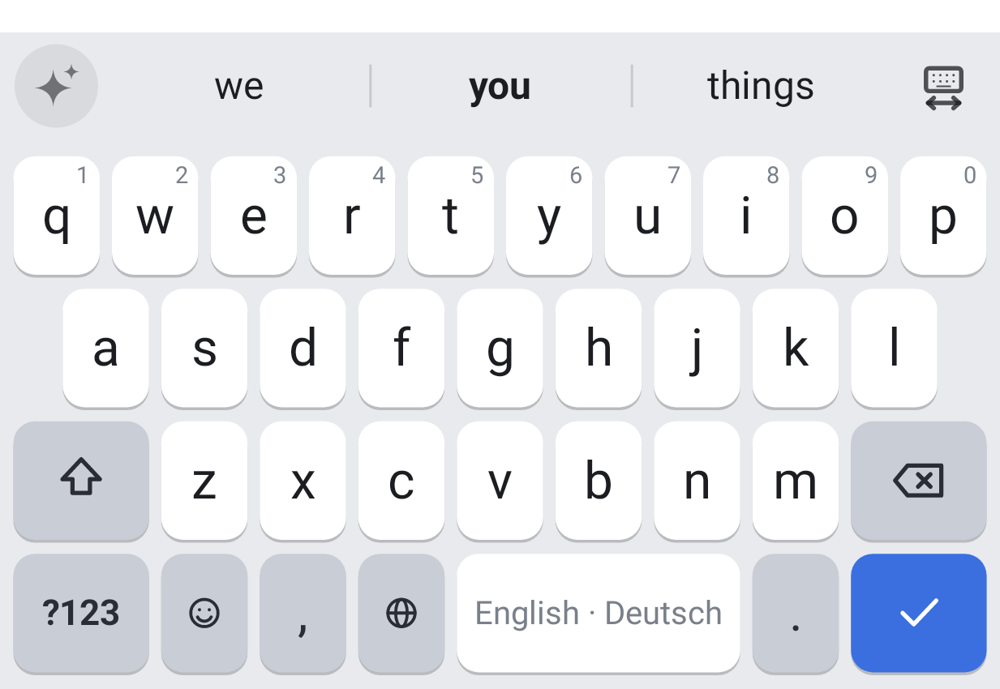 | 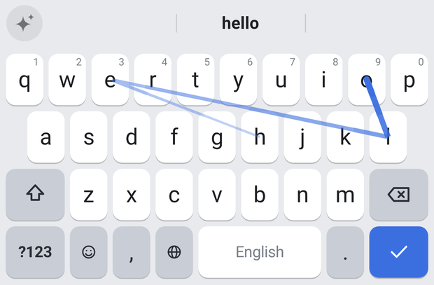 | 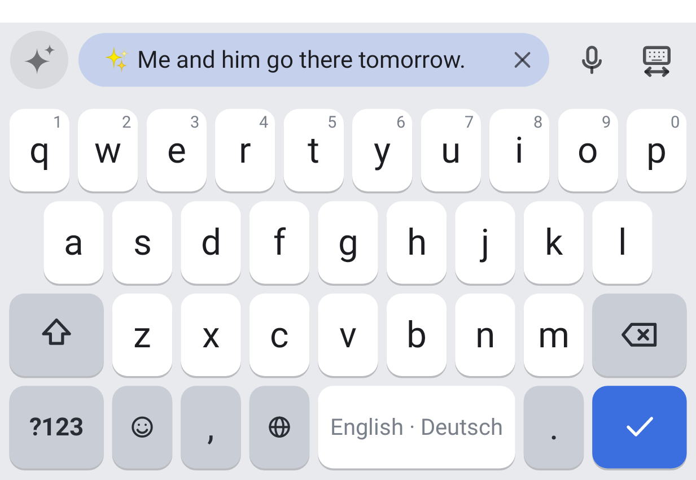 |
| **Themes** | **Arabic** | **Emoji** |
| 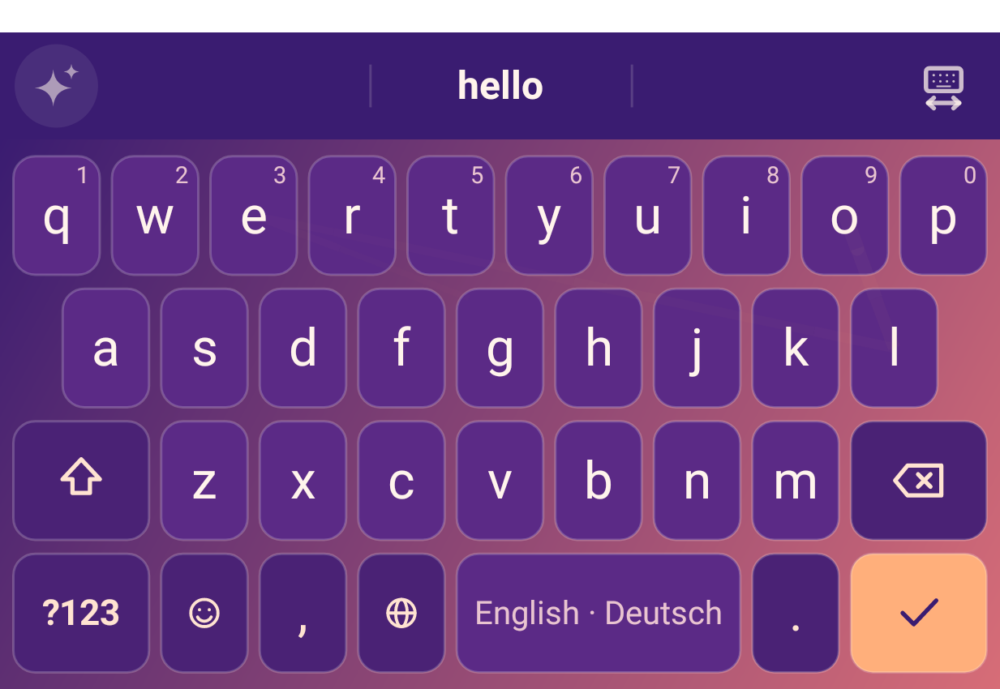 | 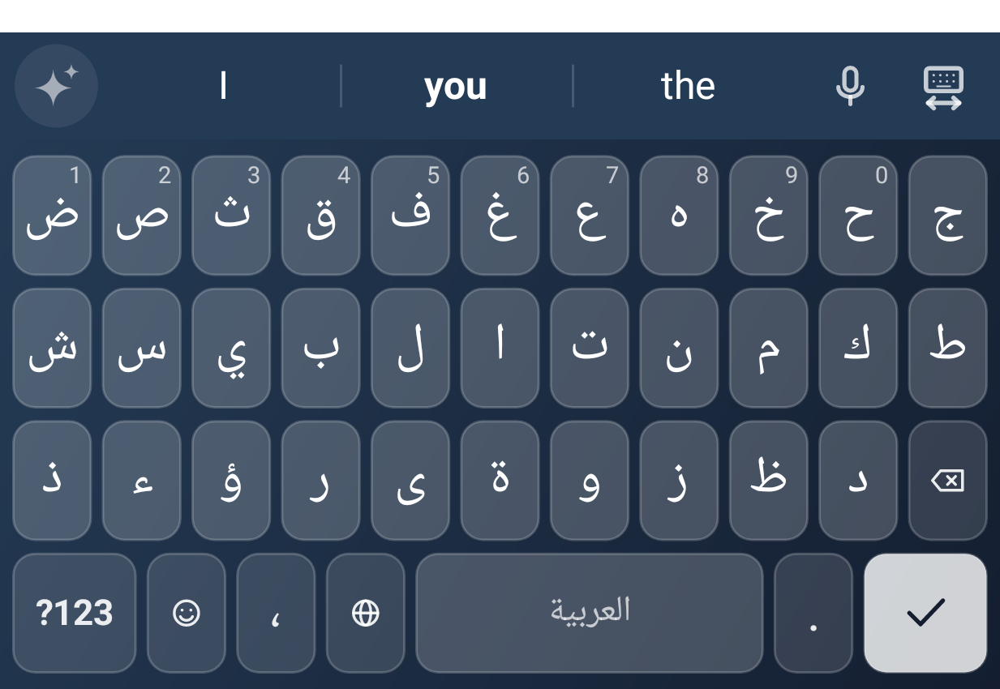 | 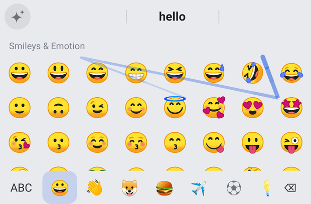 |
| **German on the English keyboard** | **German (QWERTZ)** | **Long-press accents** |
| 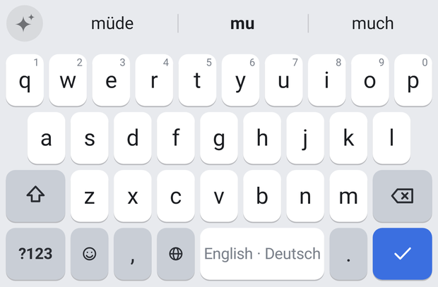 | 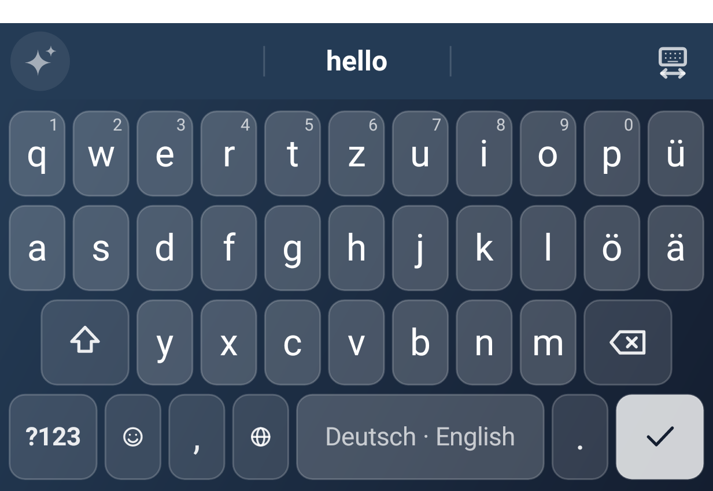 | 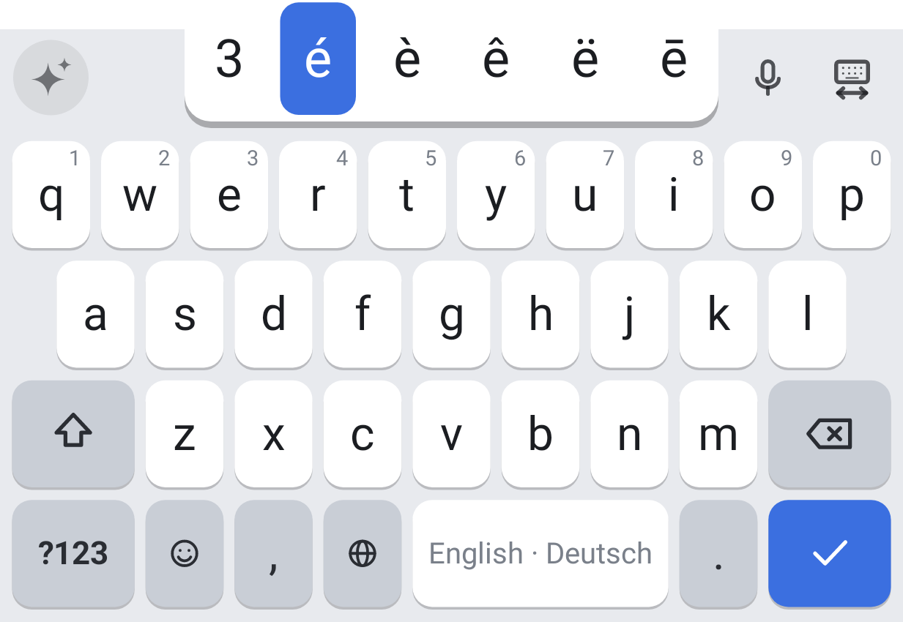 |
| **Arabizi: 7abib → حبيب** | **Voice typing** | **Your own colours + rainbow trail** |
| 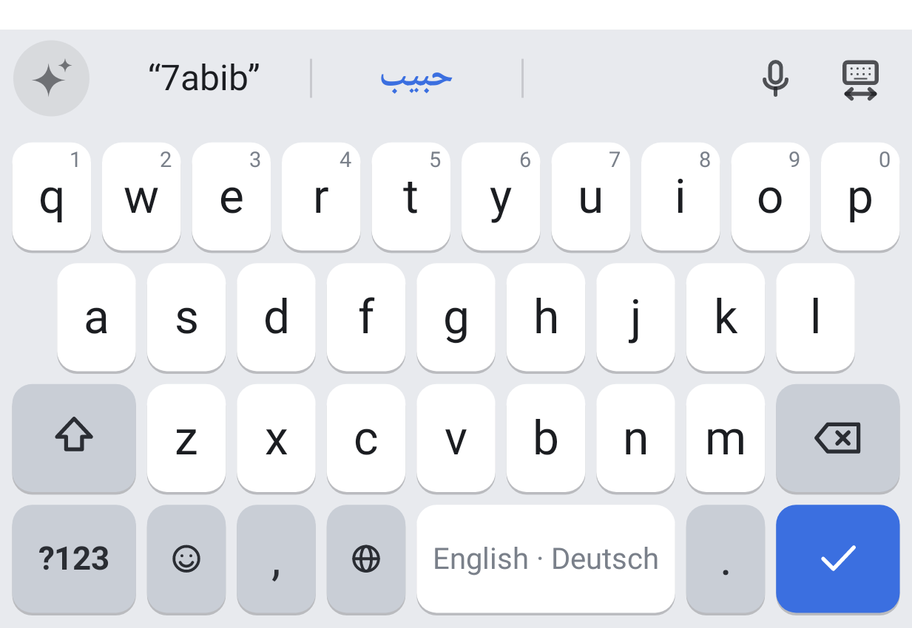 | 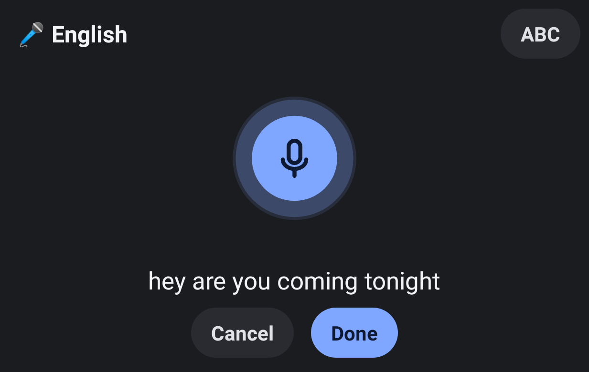 | 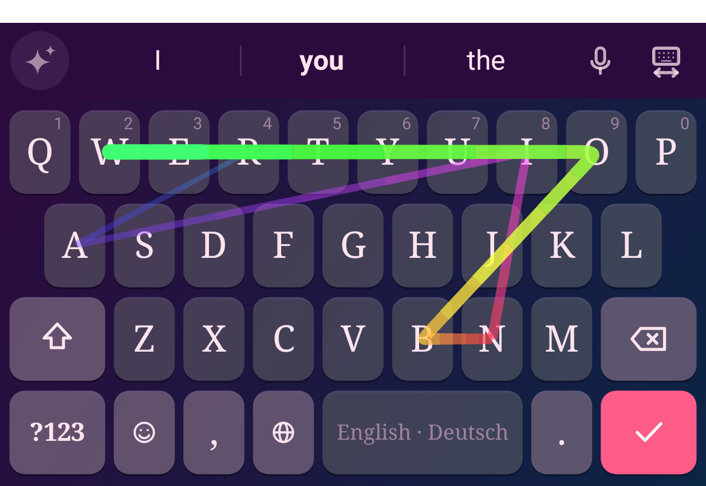 |

<p align="center">
  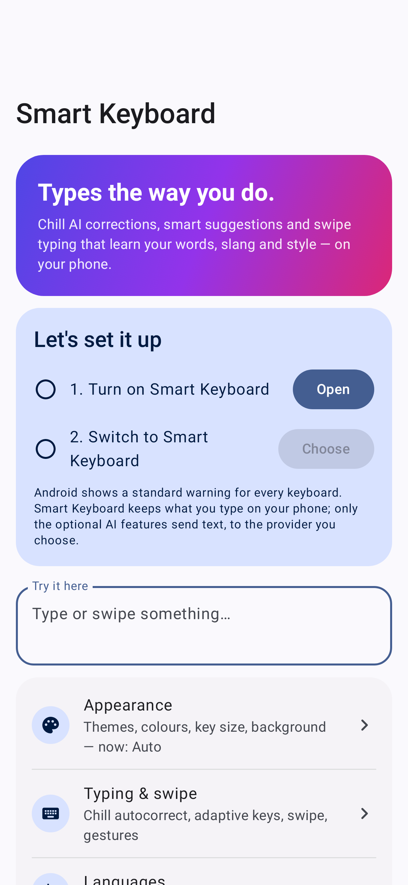
  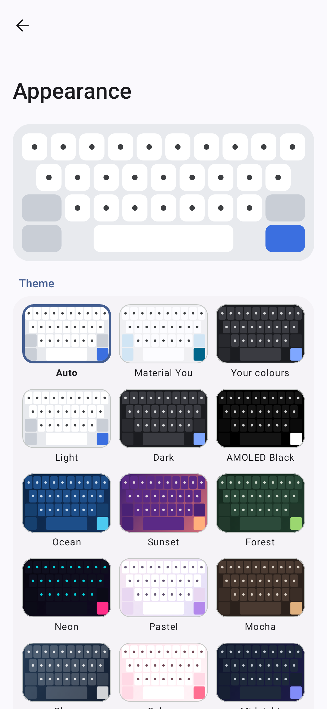
  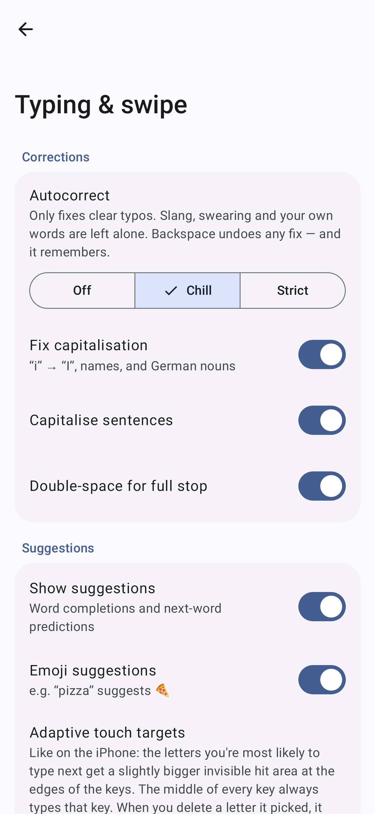
  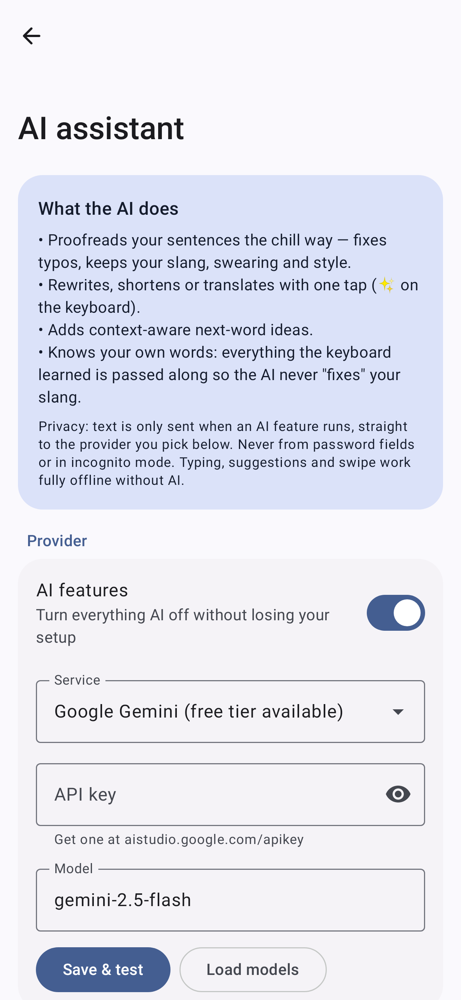
  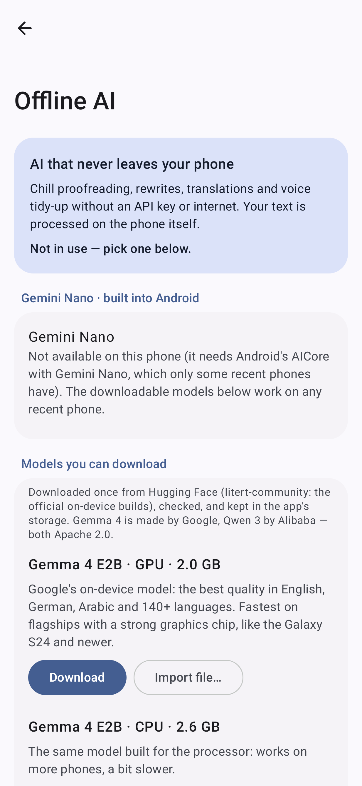
</p>

## Install

1. Download `SmartKeyboard-vX.Y.Z.apk` from the [latest release](https://github.com/ItzSuli/Smart-Keyboard/releases/latest) and open it (allow "install unknown apps" for your browser or file manager when asked).
2. Open **Smart Keyboard** and follow the two setup steps (turn it on, then switch to it).
3. Optional: turn on AI proofreading. Either **AI assistant → Offline AI** (download a model once; no key, no internet, nothing leaves the phone) or paste an API key (Google Gemini has a free tier).

## What it does

### Chill corrections
- **Only clear typos get fixed.** `teh → the`, `becuase → because`, `dont → don't`, `helo → hello`. Real words, slang (`idk`, `ngl`, `bruh`, `digga`, `wallah`, `يلا` …) and swearing stay exactly as typed, and there are no weird built-in shortcuts.
- **Backspace undoes any fix — and it's remembered.** Undo `teh → the` once and it will never touch `teh` again.
- Benchmarked in `engine/src/test/.../AutocorrectBenchmarkTest.kt`: fixes 77 of 78 real-world misspellings (98.7 %) and leaves all 54 slang, swear and casual words in its "leave alone" list untouched.
- Three modes: **Off**, **Chill** (default) and **Strict**.

### Mixed typing: English and German on one keyboard
Write German on the English keyboard (or any mix of Latin-script languages) without switching:
- It notices which language you're writing from the last few words ("ich", "und", "the", "and" decide it almost instantly) and leans towards what you write most. New sentences can switch language.
- Suggestions, next-word predictions, autocorrect and swipe all follow the current language. German words work without umlaut keys: `fur → für`, `mude → müde`, `strasse → Straße`, and long-press `u`, `a`, `o` or `s` gives `ü`, `ä`, `ö`, `ß` first.
- It never pushes one language onto the other: `und` stays `und` in an English sentence, `fur` stays `fur` in "soft fur", `im` stays `im` in "ich bin im Kino".
- Every word is learned into the language it belongs to, your slang is protected in both, and the AI proofreads "English and German" text as such.
- Turn it on under **Languages → Mixed typing** (tap *Deutsch* while on the English keyboard). It's on by default when English and German are both enabled. Swipe accuracy on English words barely changes with German mixed in (95.0 % vs 95.7 % top-1, no context).

### Arabizi
Type Arabic with Latin letters and numbers, the way people chat: `7abibi → حبيبي`, `3arabi → عربي`, `2albi → قلبي`, `kifak → كيفك`, `5alas → خلاص`.
- On the English (or any Latin) keyboard when Arabic is one of your languages. Words with Arabizi numbers (2 3 5 6 7 8 9) convert on space; right after Arabic, plain Latin Arabizi does too. Everything else just gets an Arabic suggestion, so English stays English (`gr8`, `2day` are left alone).
- Backspace undoes a conversion and it's remembered; picking an Arabic suggestion teaches it how *you* spell that word.
- Prefers everyday dialect words (Levantine, Gulf, Egyptian, Maghrebi) over formal Arabic. 95 % right first time, 100 % in the top three on a 60-word chat benchmark (`ArabiziTest`).

### Smart, learning suggestions
- Completions and next-word predictions from a trigram language model built from everyday spoken language (subtitles) and conversational sentences.
- Personal model: every word you send teaches it your vocabulary, your phrases and your habits, and the more you type the more your own style wins. New words and slang are learned after you use them twice.
- Picking a correction teaches it that typo; long-pressing a suggestion blocks it forever.
- Emoji suggestions that replace the word when you tap them (`sob` → 😭, `pizza` → 🍕, `liebe` → ❤️, `hahaha`/`هههه` → 😂), for swiped words too. The emoji panel opens on your recently used emoji.

### Offline AI — on your phone
- **No key, no internet, nothing leaves the phone.** Download one model once (Settings → AI assistant → Offline AI): **Gemma 4 E2B** (Google, best quality in English, German, Arabic and 140+ languages, 2.6 GB, fast on flagships such as the Galaxy S24), **Qwen 3 1.7B** (1 GB) or **Qwen 3 0.6B** (345 MB). Runs with Google's LiteRT-LM runtime on the GPU or CPU; a quick self-test on first load skips a chip that gives garbled answers, and every AI answer is checked (right alphabet, no random emoji, still your text) before it may change anything.
- **Gemini Nano** is used on phones where Android has it built in (AICore).
- Everything AI works with it: chill proofreading, rewrites, translation, voice tidy-up. With an online provider it can also step in automatically when there's no internet.

### AI assistant (optional, bring your own key)
- **Proofread the chill way.** It fixes typos and grammar slips but keeps your tone, slang, swearing, emoji and lowercase style. Your learned words are sent along so the AI never "corrects" them.
- **Auto-proofread each sentence**: Manual, Suggest (a one-tap fix appears in the bar) or Auto-fix (tap to undo).
- **Tone per app**: chill in WhatsApp, Snapchat and Instagram, clean in Slack and Teams, polite in Gmail and Outlook — automatically, and you can change any app.
- **Rewrite** (chill, friendlier, formal, shorter, expand, add emoji) and **translate** (English ⇄ German ⇄ Arabic and every other enabled language) with a diff preview before applying.
- **AI next-word ideas** blended into the suggestion bar.
- **Learning loop**: typo fixes you accept from the AI become instant on-device autocorrections.
- Providers: **Google Gemini**, **Anthropic Claude** (official Java SDK; Opus 5.5 for best quality, Haiku 5.5 for speed), **OpenAI**, **Groq**, **OpenRouter**, or any OpenAI-compatible server such as a local **Ollama**.

### Voice typing
- Tap 🎤 on the suggestion bar and talk. Uses your phone's on-device speech recogniser when it has one (audio stays on the phone).
- What you said goes through the same chill proofreading, in the app's tone; the AI's fix can be undone with one tap.

### Swipe typing
- Glide over the letters. The decoder resamples your path, keeps only words whose letters the path visits in order, then scores shape with dynamic time warping, combined with sentence context and your personal words. Your slang can be swiped too.
- Live word preview while swiping, smooth fading comet trail, alternatives in the bar, automatic spacing.
- After a swiped word, tapping a letter starts a new word with a space ("hello" + "I" → "hello I"), and one backspace removes the whole swiped word (can be turned off).
- 96.5 % top-1 and 100 % top-3 accuracy on 400 common words with simulated sloppy gestures, about 2 ms per word (`SwipeDecoderTest`).

### iPhone-style adaptive keys
The letters you're most likely to type next get a bigger *invisible* hit area. It uses the current word, the sentence context and your own vocabulary. Only the outer edge of a key is shared with its neighbours: the middle three quarters of every key always type that key, and how far a likely letter can reach is capped. When you delete a letter it picked ("kis" instead of "kid"), it backs off for that pair of keys from then on. The keyboard also learns where *you* actually hit each key and shifts its targets over time.

On simulated thumb typing (`AdaptiveKeysBenchmarkTest`), "Balanced" cuts mistyped letters from 2.5 % to 0.8 % (careful typing) and from 13.8 % to 6.0 % (sloppy typing), while changing only 0.2–0.4 % of taps that were already on the right key.

### Everything else
- **11 languages**, each with its own layout, dictionary, slang and swear words, and its own learned data: English, German (QWERTZ, ä ö ü ß), Arabic (with Arabic-Indic digits option), French (AZERTY), Spanish, Italian, Portuguese, Turkish, Dutch, Russian and Polish. Switch with 🌐.
- **Looks**: 25 themes plus Material You, Auto (light/dark) and **your own colours** (background with optional gradient, keys, letters, any accent colour), your own background picture, 7 key fonts, capital letters on keys, key shadows, swipe trail colour (accent, rainbow, letters) and thickness, key shape/gap/height/letter size, number row, flat or key-background style.
- **Your own shortcuts**: only the ones you add ("omw" → "On my way!"), offered as a suggestion or expanded on space — never anything built in.
- **Sync between phones**: everything the keyboard learned plus your settings, end-to-end encrypted (AES-256, your passphrase) in one file you keep in Google Drive or any folder. A fresh install that picks the file again gets everything back.
- **Updates from inside the app** (Settings → Updates & backup): downloads the newest release from GitHub and installs it over the old one, keeping your settings, words and offline model.
- **Works with every app's enter key**: Send in Snapchat, WhatsApp and other chats, Search, Go, Next, Done. Long-press enter for a new line.
- **Switch-keyboard button** on the right of the suggestion bar: tap to pick another keyboard app, hold to jump to the next one (can be hidden).
- **Haptics that feel right**: crisp clicks from your phone's precise haptic engine (Crisp, Soft, Classic or exactly like the System keyboard), lighter ticks that speed up with held delete, and a cursor tick only when the cursor really moves.
- **Quality of life**: long-press for accents, numbers and symbols; slide on space to move the cursor; swipe left from ⌫ to delete whole words; double-space for a full stop; smart punctuation spacing; clipboard history with pins (password clips are skipped); emoji panel with skin tones; sound with adjustable volume; incognito mode.
- **Your data**: everything learned stays on the phone. Manage your own words, learned fixes and blocked words, save or restore a backup (settings, words, fixes, shortcuts), or reset.

## Privacy

Typing, suggestions, autocorrect, swipe, Arabizi and all learning run on the device. The internet permission is only used by the optional online AI features, which talk directly to the provider you configure with your own key, to download an offline model once if you choose one, and to look for app updates on GitHub. With offline AI nothing is sent anywhere. Voice typing uses the phone's speech recogniser (the on-device one when available) and the microphone only while the 🎤 panel is open. Sync files are encrypted on the phone with your passphrase before they're saved. Nothing is ever learned from, or sent to an AI from, password fields, incognito mode or apps that ask for no personalised learning. Learned data is excluded from Android cloud backups; use the built-in export instead.

## Project layout

```
engine/   Pure-Kotlin typing engine (no Android): dictionaries, language model, corrector,
          swipe decoder, adaptive key prediction, learning. Fast JVM tests + benchmarks.
app/      The Android app: keyboard service and views (ime/), AI providers (ai/),
          storage (data/), Compose settings app (settings/), Robolectric tests.
tools/    build_dictionaries.py — rebuilds the language packs from the open data sources.
docs/     Design notes, release/signing guide, screenshots.
```

Build locally with JDK 17+ and the Android SDK:

```bash
./gradlew :engine:test :app:testDebugUnitTest   # engine benchmarks + end-to-end keyboard tests
./gradlew :app:assembleDebug                    # debug APK
```

Every push runs the tests on GitHub Actions. Releases are published from `main`, from `v*` tags, or from any commit whose message contains `[release]`; see [docs/RELEASING.md](docs/RELEASING.md).

## Credits

- Word frequencies: [FrequencyWords](https://github.com/hermitdave/FrequencyWords) by Hermit Dave (OpenSubtitles 2018), CC BY-SA 4.0
- Context data and capitalisation: [Tatoeba](https://tatoeba.org) sentences, CC BY 2.0 FR
- Emoji data: Unicode `emoji-test.txt`, Unicode License v3
- Claude provider: [Anthropic Java SDK](https://github.com/anthropics/anthropic-sdk-java), MIT
- Offline AI runtime: [LiteRT-LM](https://github.com/google-ai-edge/LiteRT-LM), Apache 2.0; Gemini Nano through [ML Kit GenAI](https://developers.google.com/ml-kit/genai)
- Offline models (downloaded on request, not bundled): [Gemma 4 E2B](https://huggingface.co/litert-community/gemma-4-E2B-it-litert-lm) by Google and [Qwen 3](https://huggingface.co/litert-community/Qwen3-1.7B) by Alibaba, both Apache 2.0
